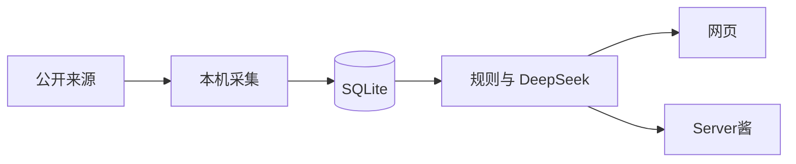

# myy-hot-monitor

本地运行的 AI 热点监控。它从多个公开来源采集内容，把同一件事收成一条故事，用中文放在网页上，并按你设的关键词提醒。需要时，可以把当天的首页和关键词命中经 [Server酱](https://sct.ftqq.com/) 推到微信。

进程开在你自己的机器上。密钥只放在后端，页面和接口都不回传密钥。默认只监听 `127.0.0.1`。

## 功能

- **热点。** 近 7 天、有发布时间的故事。微博热搜和 B 站热门会采集，但不进首页。搜索结果只留已知科技站点、官方博客、机器之心和量子位。单独一条 Hacker News 或 GitHub 帖子要有第二个来源才显示。过了筛选的 X 帖可以单独出现。
- **中文摘要和可信度。** 配置了 DeepSeek 时，新故事会生成中文摘要，首页候选会被判成可靠、不确定或不采纳。没有密钥，或模型连续失败时，只使用本地规则，并标出「未经过模型核实」。
- **监控。** 添加、暂停、删除关键词。命中后记一条站内通知。配置了 Server酱 才发微信。
- **日报。** 按北京时间每天推一次。默认关闭，要在设置里打开。日报页保留最近 30 次发送记录，不存正文。
- **发现。** 自己添加关注方向（名称加最多 5 个词）。方向里的词会参与搜索，命中的故事要经过核对才显示。
- **设置。** 开关每个来源、立即采集、设定日报、维护可信域名和可信 X 账号。

## 怎么工作



采集、打分、匹配和定时任务都在同一个 Node 进程里。网页通过 Vite 把 `/api` 转到这个进程。SQLite 文件默认在 `server/data/hot.sqlite`。

定时日报到点后，先采主源（热榜、RSS、Hacker News、GitHub、arXiv、默认搜索、默认的 X 查询），打分并匹配已有故事，然后发日报。关键词和兴趣词的搜索放在日报之后，不挡住这一封。这些词搜的命中会进站内通知，并出现在下一封日报里。手动「立即采集」仍会把主源和词搜跑完再收尾。

电脑关机或进程没开时，到点的那一次不会补做。

## 技术栈

| 部分 | 选用 |
| --- | --- |
| 前端 | React 19、Vite、React Router、TanStack Query、Tailwind CSS 4 |
| 后端 | Node.js 22、Express 5、Drizzle ORM、better-sqlite3 |
| 定时 | croner，时区 `Asia/Shanghai` |
| 共享类型 | `shared/`，前后端共用 |
| 测试 | Vitest、Playwright |

仓库是 npm workspaces：`shared`、`server`、`web`。

## 环境

- Node.js **22.12 或更新**
- npm（使用仓库里的 workspaces）
- 可选：DeepSeek API 密钥、[twitterapi.io](https://twitterapi.io/) 密钥、Server酱 SendKey
- 端到端测试使用本机已安装的 Microsoft Edge

没有这三个密钥也能启动。没有 DeepSeek 时只走规则；没有 twitterapi.io 时跳过 X；没有 Server酱 时通知留在站内，日报记为未配置。

## 开始使用

在仓库根目录：

```bash
npm install
```

复制环境文件。Windows PowerShell：

```powershell
Copy-Item server\.env.example server\.env
```

macOS 或 Linux：

```bash
cp server/.env.example server/.env
```

打开两个终端，都在仓库根目录：

```bash
npm run dev:server
```

```bash
npm run dev:web
```

- 网页：<http://localhost:5173>
- 健康检查：<http://127.0.0.1:3001/api/v1/health>

`server/.env` 已被 git 忽略。不要把密钥提交进仓库。数据库文件 `server/data/` 同样不入库。

当前没有把前端构建结果挂到 Express 上。日常使用就是上面两个开发进程。`npm run build` 只构建网页。

## 配置

写在 `server/.env`。留空表示不用这项。

| 变量 | 作用 | 默认 |
| --- | --- | --- |
| `PORT` | API 端口 | `3001` |
| `HOST` | 监听地址 | `127.0.0.1` |
| `DB_FILE` | SQLite 路径，相对 `server/` | `data/hot.sqlite` |
| `HEARTBEAT_INTERVAL_SEC` | 心跳间隔，1–59 秒 | `30` |
| `DEEPSEEK_API_KEY` | DeepSeek 密钥 | 空 |
| `DEEPSEEK_MODEL` | 只接受 `deepseek-v4-flash` 或 `deepseek-flash`，其他值会用主模型 | `deepseek-v4-flash` |
| `TWITTERAPI_IO_API_KEY` | X 采集密钥 | 空 |
| `TWITTER_DAILY_TWEET_CAP` | X 每日条数上限，最大 150 | `150` |
| `SEARCH_MIN_INTERVAL_SEC` | 搜索最小间隔（秒），至少 90 | `90` |
| `SEARCH_DAILY_CAP_PER_ENGINE` | 每个搜索引擎每天最多请求数，最大 80 | `80` |
| `CRAWLER_CONTACT` | 写进爬虫 User-Agent 的联系方式 | `unset` |
| `SERVERCHAN_SENDKEY` | Server酱密钥。`SCT` 走 Turbo，`sctp` 开头走 Server酱³ | 空 |

示例文件里还有一组 SMTP 变量。当前版本不发邮件，这些变量不会被读取。

`HOST` 可以改，但接口没有登录。只在你信任的网络上改成非本机地址。

## 页面

**热点。** 先显示 15 条，其余在「更多」里。标题优先用模型写的中文事件句。卡片会标「新上榜」或「多了 N 个来源」。标题和来源徽章只在地址是 `http` 或 `https` 时可以点开。

**监控。** 关键词最长 40 字，不区分大小写，重复的加不进去。整句出现，或关键词里至少 4 个字符的英文词出现在标题、中文摘要或原文里，算命中。暂停后再打开，只从打开的时刻往后算，不补发旧故事。这一轮主源没有命中时，页面写「这次采集没有命中关键词。」

命中还要经过核对：没有可用来源链接、或触发仿冒和诈骗规则时直接拒绝。模型认为材料和关键词对得上、并且说法有来源支撑时，才记通知、才可能发微信。

**日报。** 设置里选择北京时间的时和分，以及两个范围：首页当天的故事、当天的关键词命中。默认 08:00，首页开、关键词关、每天推送关。同一天的定时日报成功后不再发第二次。手动「立即发送」不占用这次名额。最多 15 条。没有内容不会请求 Server酱。

**发现。** 最多 20 个方向。每个方向 1 到 5 个词，每个词最长 40 字。

**设置。** 可以看到每个来源今天的请求数和状态，并单独关闭某个来源。关闭后这一轮不请求它。可信名单可以加域名或 X 账号。第一次启动、名单还是空的时候，会写入一份内置的官方账号和官方域名。之后删掉的不会在重启时补回。

## 来源与限额

| 来源 | 说明 |
| --- | --- |
| 微博热搜、B 站热门 | 采集入库，不进首页 |
| RSS | 机器之心、量子位、OpenAI、Anthropic、Google AI、Hugging Face |
| Hacker News、GitHub、arXiv | GitHub 搜近 7 天 `topic:llm`；arXiv 取 cs.AI、cs.CL、cs.LG 最新 10 条 |
| 搜狗、Google、DuckDuckGo | 默认查询是「人工智能」。关键词和兴趣词不走 Google，只用搜狗或 DuckDuckGo 里还没到上限、也没被暂停的一个 |
| X | 默认查询「AI」，时间窗约 24 小时。关键词和兴趣词的查询窗是 7 天 |

搜索请求串行，间隔至少 90 秒，再加 0–30 秒随机抖动。每个搜索引擎每天最多 80 次，X 每天最多 150 条。遇到验证页会把该来源暂停到下一个北京时间 0 点。某个来源超时或失败时，其余来源继续。

X 在入库前就筛选：官方账号，或粉丝不少于 10 万；浏览量少于 1000 的丢掉。浏览量缺失时只留官方账号。内置官方账号包括 OpenAI、Anthropic、Google、DeepMind、xAI、Meta AI、Hugging Face、NVIDIA、Microsoft、GitHub、DeepSeek 等已公开账号。设置里添加的可信账号按同样规则放行。

去重按规范网址和 SimHash。同一条推文只按推文编号合并，不因为标题相似并进其他来源。B 站按 `bilibili.com` 上的 BV 号合并。向量去重目前关闭。

热度只由规则计算：来源多少、条目多少、是不是热榜、新不新。可信度先算规则分。有模型分时与规则分取折中。仿冒、黑名单或诈骗用语把最终可信度封在 30 分。

DeepSeek 请求发往 `https://api.deepseek.com/chat/completions`。主模型是 `deepseek-v4-flash`；接口若拒绝这个模型名，再试 `deepseek-flash`。单次超过 20 秒就中止。连续失败 3 次后，5 分钟内不再调用模型，采集不中断。本地不设每日调用上限，设置页只显示当天次数。

## 数据

SQLite 使用 WAL。启动时自动执行 `server/drizzle/` 里的迁移。

每轮采集会清理：

- 已过期的抓取缓存
- 超过 30 天的模型响应缓存
- 抓取时间早于 14 天的条目
- 已经没有任何条目、通知和核对记录的故事

带通知或核对记录的故事会留下。通知正文存在通知表里，不依赖故事原文。

## 开发

```bash
npm run typecheck
npm test
npm run test:e2e
```

`npm test` 跑 `server` 和 `web` 的 Vitest。端到端测试会自己拉起 API 和网页，并用本机 Edge 打开三个视口。设计过程中的笔记在 `docs/`，和代码不一致时以代码和本文件为准。

```
shared/src/index.ts      前后端共用的响应类型
server/src/index.ts      进程入口、定时任务、退出
server/src/app.ts        HTTP 接口
server/src/collect/      采集、去重、入库
server/src/ai/           DeepSeek、规则分、核对
server/src/notify/       关键词通知、日报、Server酱
server/src/discover/     发现方向
server/drizzle/          手写迁移
web/src/                 页面
e2e/                     Playwright
```

接口前缀是 `/api/v1`。常用的有：

| 方法 | 路径 | 作用 |
| --- | --- | --- |
| `GET` | `/health` | 进程时间、心跳、三个密钥是否已配置 |
| `GET` | `/stories` | 首页故事，`limit` 为 1–100 |
| `GET` | `/sources` | 来源状态；采集中约每 2 秒被页面轮询 |
| `POST` | `/collect` | 开始一轮完整采集。已在跑时返回 409 |
| `GET` `POST` `PATCH` `DELETE` | `/watches` | 关键词 |
| `GET` `PUT` | `/digest` | 读、存日报设置 |
| `POST` | `/digest/send` | 按已保存的范围立即发送 |
| `GET` `POST` `PATCH` `DELETE` | `/discover` | 发现方向 |
| `GET` `POST` `DELETE` | `/trusted` | 可信域名和 X 账号 |
| `PATCH` | `/sources/:id` | 打开或关闭一个来源 |

变更类接口用 JSON，字段不合法时返回 `400`，正文是 `{ "ok": false, "error": "bad_request" }`。

## 后续：做成 skill

现在这是一个给人打开的本地应用。下一步是把它包成一个 Agent Skill，而不是把采集逻辑再写进技能文件。

技能只负责三件事：确认本机服务已经在跑、调用上面的 HTTP 接口、把故事、命中和日报整理成回答。密钥继续只放在 `server/.env`。技能描述里写清什么时候该查热点、什么时候该加关键词、什么时候不该改监听地址。这一步还没有做，仓库里也还没有对应的 `SKILL.md`。

## 限制

- 单用户、本机进程。没有账号系统。
- 搜索间隔和每日上限是故意做慢的，用来降低被搜索引擎拦住的可能。词多的时候，词搜会明显长于主源采集。
- 日报内容来自发送前已经入库的故事。词搜结果赶不上下一封，要等下一次定时日报。
- 不解决验证码，不用代理，也不伪装浏览器指纹。User-Agent 里会带上 `CRAWLER_CONTACT`。
- 仓库还没有选择开源许可证。在加上许可证之前，别人没有默认的使用、修改和再分发许可。

## 问题

使用和改动上的问题，请在 GitHub 仓库开 Issue。提交代码前先跑 `npm run typecheck` 和 `npm test`。
